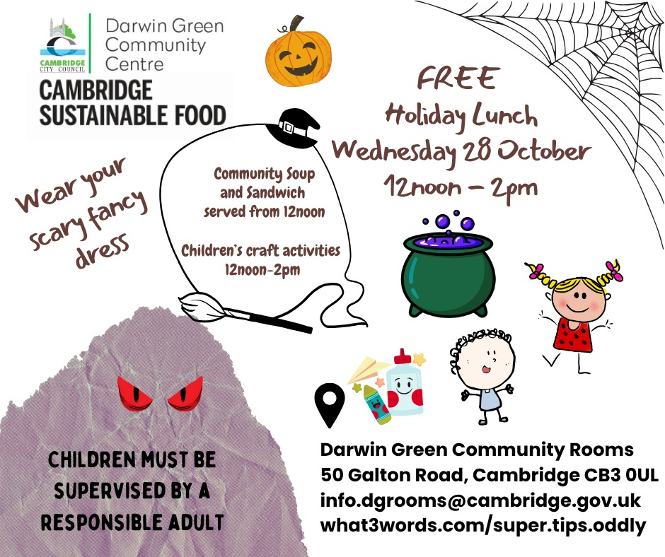

Children are invited for a free holiday lunch, provided by [Cambridge
Sustainable Food] and organised by the Council, at the Darwin Green Community
Rooms on **Wednesday 28th October 2026, from 12 pm to 2 pm**.

This half-term edition has a Halloween theme, so don't hesitate to dress up!
Soup and sandwiches will be served from noon, and children will be able to
enjoy craft activities until 2 pm. This is a good opportunity for them to meet
other children from the neighbourhood and enjoy some spooky fun together.

Please keep in mind that all children attending must always be under the
supervision of a responsible adult.

For more information, contact <info.dgrooms@cambridge.gov.uk>, or by phone:
[01223 457500](tel:+441223457500).

[Cambridge Sustainable Food]: https://cambridgesustainablefood.org/
