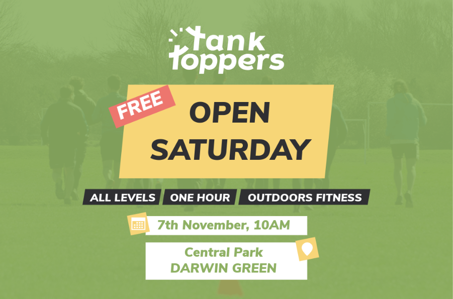

A fitness camp called [TankToppers] will offer two free taster sessions, **on 7
and 28 November 2026, at 10 am in Darwin Green's Central Park**.

The sessions will last one hour. All levels are welcome.

TankToppers may run follow-up sessions after that, outdoors or indoors once the
Sports Pavilion is available, although they will likely not be free. Please
**[fill this form][form]** if you consider attending regular sessions in the
future: this will help the organisers understand whether there is interest, and
days in the week would work best for people.

The form says:

> We are fitness enthusiasts running an outdoor fitness community dedicated to
> making exercise social, functional, and fun. Our 1-hour sessions blend
> strength training, cardio circuits, and teamwork—all scaled to fit your
> individual fitness level, whether you're a complete beginner or a seasoned
> athlete. No stuffy gyms, no mirrors—just fresh air, great music, and an
> amazing community supporting each other.

Join the sessions to enjoy some exercise in the park!

[TankToppers]: https://www.cambridgeoutdoorsfitness.com/
[form]: https://docs.google.com/forms/d/e/1FAIpQLSdeLBd4RD330rFNw190Bq5ZQx6OEF7qmgmJmhXgzzAnZzHQ0g/viewform
